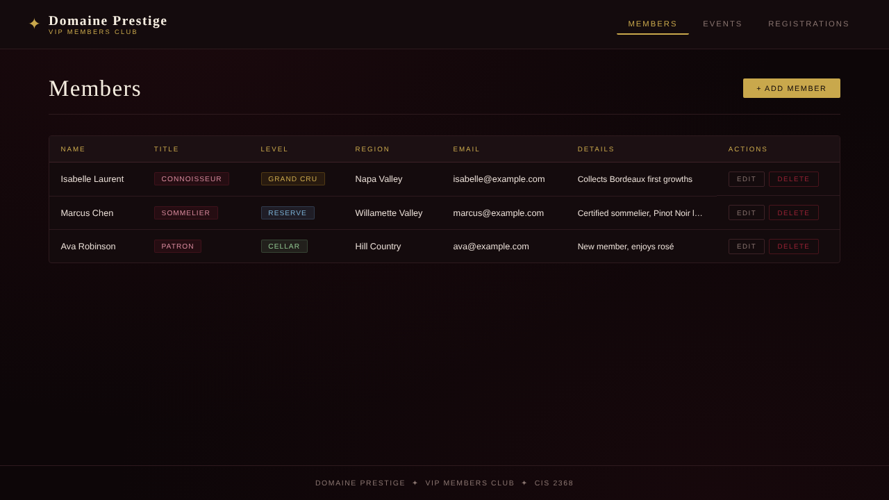
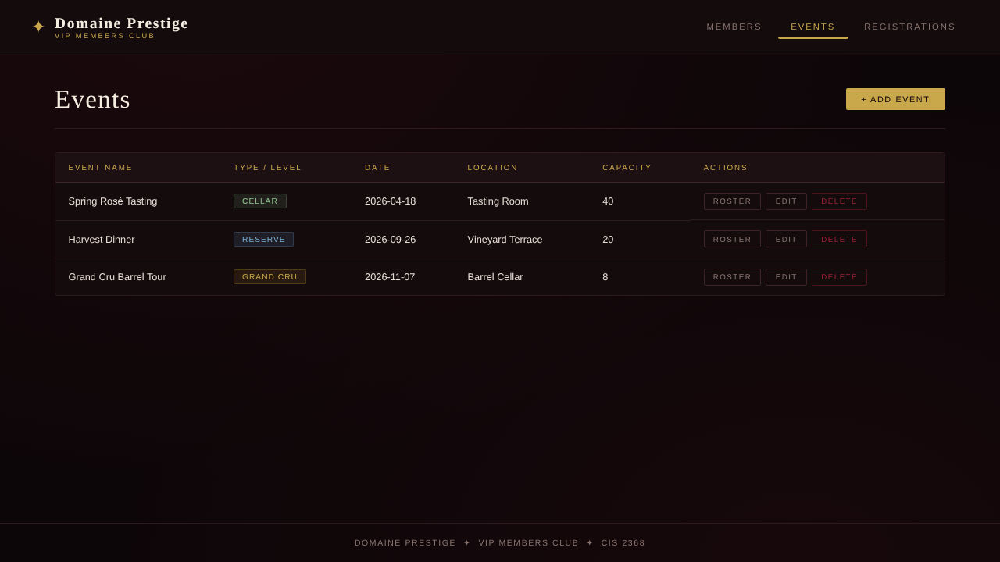
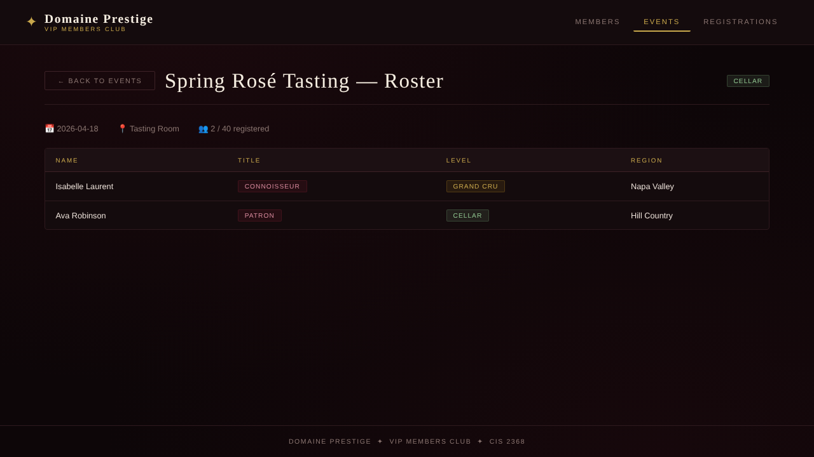

# Domaine Prestige — VIP Winery Members Club

A full-stack membership app for a private winery club. Staff can manage members and events, register members for tastings and tours, and see each event's guest list. The app enforces the club's rules automatically.

Built with a **Python/Flask REST API**, a **MySQL** database and a **Node.js/Express/EJS** frontend.



## Features

- **Full CRUD** for members, events and registrations through a REST API
- **Membership tiers:** Cellar (Bronze) → Reserve (Silver) → Grand Cru (Gold)
- **Business rules enforced by the API:**
  - Members can only register for events at or below their tier (403 if not)
  - Events can't go over capacity
  - A member can't register for the same event twice
  - Only one event can be scheduled per date
- **Event roster:** see who's registered for any event and how full it is
- **Security:**
  - Parameterized SQL queries (no SQL injection)
  - Input validation with clear JSON error messages
  - Credentials loaded from environment variables
  - No user data in inline JavaScript

| Events | Roster |
|---|---|
|  |  |

## Tech stack

| Layer | Tools |
|---|---|
| Backend | Python, Flask, mysql-connector-python, python-dotenv |
| Database | MySQL |
| Frontend | Node.js, Express, EJS, Axios, vanilla JS, CSS |

## How it works

```
Browser ──► Node/Express (port 3000) ──► Flask REST API (port 5000) ──► MySQL
            renders EJS pages,            business rules +
            proxies form actions          parameterized SQL
```

## API endpoints

| Method | Endpoint | Description |
|---|---|---|
| GET / POST | `/members` | List all members / add a member |
| GET / PUT / DELETE | `/members/<id>` | Get, update or delete a member |
| GET / POST | `/events` | List all events / add an event |
| GET / PUT / DELETE | `/events/<id>` | Get, update or delete an event |
| GET / POST | `/registrations` | List all registrations / register a member for an event |
| GET | `/registrations/event/<id>` | Roster for one event |
| DELETE | `/registrations/<id>` | Remove a registration |

## Running it locally

**Requirements:** Python 3.10+, Node.js 18+ and MySQL 8 (or MariaDB).

**1. Create the database** (this includes sample data):

```bash
mysql -u root -p < backend/schema.sql
```

**2. Start the API:**

```bash
cd backend
python -m venv venv
venv\Scripts\activate          # Windows  (macOS/Linux: source venv/bin/activate)
pip install -r requirements.txt
copy .env.example .env         # macOS/Linux: cp .env.example .env
# then edit .env with your MySQL username and password
python vip.py
```

**3. Start the frontend** in a second terminal:

```bash
cd frontend
npm install
npm start
```

Then open <http://localhost:3000>.

## About

Built by **Michelle Gilmore** as the final project for CIS 2368 (Advanced Information Systems Development) at the University of Houston. Sprint 1 was the Flask/MySQL API, and Sprint 2 was the Node.js/EJS frontend.
